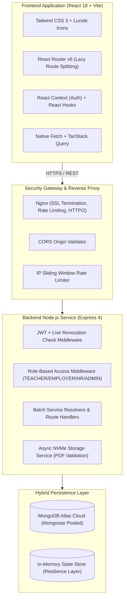

# SikchaKhub.AI — Technical Architecture Specification

**Platform:** SikchaKhub.AI  
**Target Environments:** Production (`sikchakhub.in`, `api.sikchakhub.in`) & Staging  
**Architecture Pattern:** Decoupled Single Page Application (SPA) + Micro-monolith REST Backend

---

## 1. Architectural Layers Overview



---

## 2. Frontend Architecture

### 2.1 Technology Stack
- **Framework:** React 18.2 with TypeScript 5.4.
- **Build System:** Vite 5.3 with ESBuild bundler.
- **Styling:** Tailwind CSS 3.4 with custom `@keyframes` for smooth transitions.
- **Icons:** `lucide-react` tree-shaken and isolated into a vendor bundle.
- **Routing & Code Splitting:** `react-router-dom` v6 with `React.lazy()` and `<Suspense>`.

### 2.2 Bundle Splitting & Asset Optimization
The frontend bundle has been decoupled from a monolithic 1.38MB chunk into targeted, asynchronous chunks:

| Bundle Chunk | Size (Minified) | Gzip Compressed | Content Description |
| :--- | :--- | :--- | :--- |
| `index-*.js` | 54.01 kB | 11.24 kB | Core router, layout, and global shell |
| `HomePage-*.js` | 47.44 kB | 9.89 kB | Landing page hero, search, and stats |
| `JobsPage-*.js` | 37.22 kB | 9.38 kB | Vacancy search, filters, and cards |
| `vendor-react-*.js` | 162.74 kB | 53.14 kB | React, ReactDOM, React Router |
| `vendor-icons-*.js` | 35.40 kB | 6.66 kB | Lucide UI icons |
| `vendor-query-*.js` | 41.57 kB | 12.53 kB | TanStack Query client |
| `AdminDashboard-*.js` | 261.49 kB | 43.59 kB | Loaded only on admin/HR navigation |
| `vendor-charts-*.js` | 373.08 kB | 103.47 kB | Recharts library for analytics |

---

## 3. Backend Architecture

### 3.1 Modular Structure
```
backend/
├── src/
│   ├── config/              # Environment & App Constants
│   ├── db/
│   │   ├── mongodb.ts       # MongoDB Atlas connection & Mongoose schemas
│   │   └── store.ts         # In-memory store fallback engine
│   ├── middleware/
│   │   ├── authMiddleware.ts # JWT verification & Live status checks
│   │   └── errorMiddleware.ts# Centralized async error handling
│   ├── routes/
│   │   ├── auth.routes.ts   # Registration, Login, Profile, Password
│   │   ├── jobs.routes.ts   # Vacancy CRUD, Search, Filters
│   │   ├── applications.routes.ts # Candidate applications & ATS scores
│   │   ├── interviews.routes.ts   # Interview scheduling & feedback
│   │   ├── admin.routes.ts  # Administrative oversight & dossier
│   │   └── subscriptions.routes.ts # Tiered plan & access control
│   ├── types/               # TypeScript domain contracts
│   └── index.ts             # Express bootstrap, security headers, graceful shutdown
├── uploads/                 # Local disk file store
│   ├── resumes/             # Verified PDF CVs
│   ├── certificates/       # Institutional accreditation PDFs
│   └── logos/               # Institution branding assets
└── ecosystem.config.cjs     # PM2 multi-core cluster orchestration
```

### 3.2 Request Lifecycle & Security Headers
Every incoming HTTP request passes through:
1. **Nginx Reverse Proxy:** Terminates TLS 1.3, applies sliding-window IP rate limits, and compresses responses.
2. **Security Headers Middleware:** Injects `X-Frame-Options: SAMEORIGIN`, `X-Content-Type-Options: nosniff`, `X-XSS-Protection: 1; mode=block`, and `Strict-Transport-Security`.
3. **CORS Guard:** Restricts origins to approved domains (`sikchakhub.in`, `api.sikchakhub.in`, and local development ports).
4. **JWT & Account Revocation Check:** Parses Bearer tokens and verifies user account status against MongoDB.
5. **Controller Handler:** Executes batch-optimized database queries with zero sequential N+1 round trips.

---

## 4. Resilience & Graceful Shutdown

The Node.js server registers shutdown hooks for `SIGTERM` and `SIGINT`:
```typescript
const gracefulShutdown = async (signal: string) => {
  console.log(`Received ${signal}. Closing server gracefully...`);
  server.close(async () => {
    await mongoose.connection.close(false);
    process.exit(0);
  });
};
```
This ensures active HTTP requests complete and MongoDB connections are released cleanly without corrupting writes or dropping requests during PM2 reloads.

