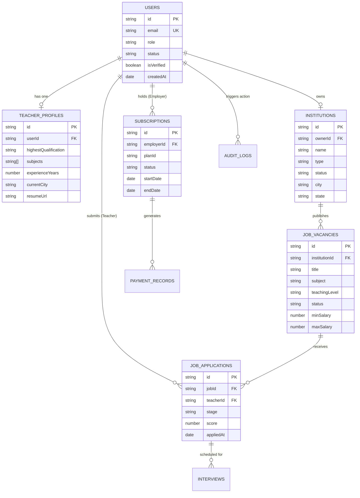

# SikchaKhub.AI — Database Architecture & Schema Specification

**Database Engine:** MongoDB Atlas (Cloud Replica Set)  
**ORM / ODM:** Mongoose 8.x  
**Connection Pool:** `maxPoolSize: 50`, `minPoolSize: 10`, `socketTimeoutMS: 45000`

---

## 1. Entity-Relationship Diagram (ERD)



---

## 2. Collections & Field Specifications

### 2.1 Collection: `users`
| Field | Type | Required | Constraints / Default | Description |
| :--- | :--- | :--- | :--- | :--- |
| `id` | String | Yes | Unique, Indexed | Custom application user ID (`usr-*`) |
| `email` | String | Yes | Unique, Lowercase, Indexed | Primary login identifier |
| `passwordHash` | String | No | Bcrypt hashed string | Not returned in public queries |
| `role` | String | Yes | Enum: `TEACHER`, `EMPLOYER`, `ADMIN`, `HR` | Core access control role |
| `status` | String | Yes | Default: `'ACTIVE'`, Enum: `ACTIVE`, `SUSPENDED`, `DEACTIVATED` | Checked on every authenticated request |
| `fullName` | String | Yes | Trimmed | User's full display name |
| `phone` | String | No | Indexed | Contact telephone number |
| `isVerified` | Boolean | Yes | Default: `true` | Email / Identity verification flag |
| `createdAt` | Date | Yes | Default: `Date.now` | Account creation timestamp |

### 2.2 Collection: `teacher_profiles`
| Field | Type | Description |
| :--- | :--- | :--- |
| `id` | String | Profile ID (`prof-*`) |
| `userId` | String | Foreign key referencing `users.id` (Unique Index) |
| `highestQualification` | String | e.g. "M.Sc Physics + B.Ed" |
| `subjects` | Array[String] | Array of taught subjects (Multikey Index) |
| `experienceYears` | Number | Classroom teaching experience in years (Indexed) |
| `currentCity` | String | Current residence city (Indexed) |
| `resumeUrl` | String | Path to verified PDF resume on NVMe storage |
| `profileCompletionScore` | Number | Score 0-100 indicating profile completeness |

### 2.3 Collection: `job_vacancies`
| Field | Type | Description |
| :--- | :--- | :--- |
| `id` | String | Vacancy ID (`job-*`) |
| `institutionId` | String | Foreign key referencing `institutions.id` (Indexed) |
| `title` | String | Job vacancy title (Text indexed) |
| `subject` | String | Primary academic discipline (Indexed) |
| `teachingLevel` | String | Level: `PGT`, `TGT`, `PRT`, `COACHING_JEE`, etc. (Indexed) |
| `board` | String | Board curriculum: `CBSE`, `ICSE`, `IB`, `CAMBRIDGE` (Indexed) |
| `minSalary` / `maxSalary` | Number | Compensation range in INR |
| `status` | String | `ACTIVE`, `DRAFT`, `CLOSED`, `PENDING_APPROVAL` (Indexed) |
| `createdAt` | Date | Creation date (Indexed for reverse chronological feeds) |

### 2.4 Collection: `job_applications`
| Field | Type | Description |
| :--- | :--- | :--- |
| `id` | String | Application ID (`app-*`) |
| `jobId` | String | Foreign key to `job_vacancies.id` (Indexed) |
| `teacherId` | String | Foreign key to `users.id` (Indexed) |
| `stage` | String | `APPLIED`, `SCREENING`, `SHORTLISTED`, `INTERVIEW_SCHEDULED`, `SELECTED`, `REJECTED` |
| `matchResult.overallScore`| Number | AI calculated ATS match score (0-100) |
| `resumeUrl` | String | Candidate resume snapshot at time of application |
| `appliedAt` | Date | Application submission timestamp |

### 2.5 Collection: `subscriptions` & `payment_records`
| Collection | Key Fields | Purpose |
| :--- | :--- | :--- |
| `subscriptions` | `id`, `employerId`, `planId`, `status`, `startDate`, `endDate`, `autoRenew` | Tracks recruiter tier (Free vs Premium Unlimited) |
| `payment_records` | `id`, `subscriptionId`, `employerId`, `amount`, `currency`, `gatewayReference`, `status` | Immutable audit ledger of financial transactions |

---

## 3. Production Indexes & Query Optimization

All schema definitions in `backend/src/db/mongodb.ts` include targeted single, compound, and multikey indexes:

```typescript
// users collection
UserSchema.index({ email: 1 }, { unique: true });
UserSchema.index({ role: 1, status: 1 });
UserSchema.index({ createdAt: -1 });

// teacher_profiles collection
TeacherProfileSchema.index({ userId: 1 }, { unique: true });
TeacherProfileSchema.index({ subjects: 1 });
TeacherProfileSchema.index({ currentCity: 1, experienceYears: 1 });

// job_vacancies collection
JobVacancySchema.index({ status: 1, createdAt: -1 });
JobVacancySchema.index({ subject: 1, teachingLevel: 1 });
JobVacancySchema.index({ institutionId: 1 });
JobVacancySchema.index({ title: 'text', subject: 'text' });

// job_applications collection
JobApplicationSchema.index({ jobId: 1, appliedAt: -1 });
JobApplicationSchema.index({ teacherId: 1, appliedAt: -1 });
JobApplicationSchema.index({ jobId: 1, teacherId: 1 }, { unique: true }); // Prevents duplicate applications
JobApplicationSchema.index({ stage: 1 });
```

### Performance Impact
- **Duplicate Application Prevention:** `{ jobId: 1, teacherId: 1 }` unique compound index guarantees that candidate applications cannot be double-submitted, even during high-concurrency race conditions.
- **Vacancy Search Acceleration:** Composite `{ status: 1, createdAt: -1 }` and `{ subject: 1, teachingLevel: 1 }` indexes eliminate in-memory sorting and full-collection table scans.
- **Batch Resolution Lookups:** Single-key indexes on `userId`, `jobId`, `institutionId` enable sub-millisecond `$in: [...]` batch joins across hundreds of related documents.

