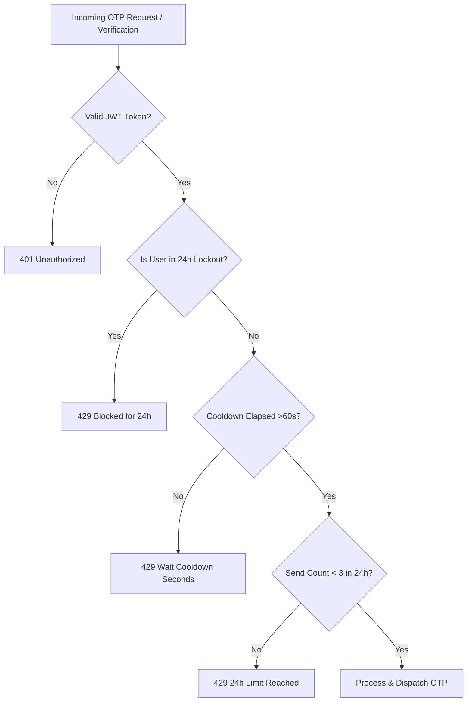

# SikchakHub.AI — OTP Security Policy & Anti-Abuse Controls

**Platform:** SikchakHub / SikchaKhub.AI  
**Target:** Email & Mobile Verification Infrastructure  
**Compliance Target:** OWASP Authentication Guidelines, Data Protection Standards

---

## 1. Cryptographic Security Standards

### 1.1 Generation

All email OTP codes are generated strictly in Node.js server memory using CSPRNG:

```typescript
import crypto from "crypto";

export function generateSecureOtp(length: number = 6): string {
  const min = Math.pow(10, length - 1);
  const max = Math.pow(10, length) - 1;
  return crypto.randomInt(min, max + 1).toString();
}
```

- OTP generation never occurs in client-side JavaScript.
- Standard pseudo-random generators (`Math.random()`) are completely prohibited for authentication tokens.

### 1.2 Salted HMAC-SHA256 Storage

Plaintext OTPs are never persisted to disk or database. Only cryptographically salted HMAC hashes are stored:

```typescript
export function hashOtp(
  otp: string,
  userId: string,
  channel: OtpChannel,
): string {
  return crypto
    .createHmac("sha256", OTP_HASH_SECRET)
    .update(`${userId}:${channel}:${otp.trim()}`)
    .digest("hex");
}
```

- The hash incorporates the `userId` and `channel` (`EMAIL` vs `PHONE`), preventing cross-channel or cross-user token transposition.
- The `OTP_HASH_SECRET` is stored as an environment variable and never checked into version control.

### 1.3 Timing-Safe Equality Verification

To prevent side-channel timing analysis that could reveal partially correct OTPs byte-by-byte, comparisons utilize `crypto.timingSafeEqual`:

```typescript
export function verifyOtpHash(
  inputOtp: string,
  storedHash: string,
  userId: string,
  channel: OtpChannel,
): boolean {
  const computed = hashOtp(inputOtp, userId, channel);
  const computedBuf = Buffer.from(computed, "hex");
  const storedBuf = Buffer.from(storedHash, "hex");
  if (computedBuf.length !== storedBuf.length) return false;
  return crypto.timingSafeEqual(computedBuf, storedBuf);
}
```

---

## 2. Anti-Abuse & Rate Limiting Controls



### 2.1 Enforced Limits

1. **60-Second Cooldown:** Independent per channel (`EMAIL` and `PHONE`). Prevents rapid-fire messaging abuse.
2. **Maximum 3 Sends per 24 Hours:** Prevents SMS toll fraud and excessive email volume.
3. **Maximum 3 Failed Attempts:** Prevents brute-force search over the 6-digit space ($10^6$ combinations). The 24-hour lockout reduces successful guessing probability to negligible levels ($3 \times 10^{-6}$).

---

## 3. Account Ownership & Cross-User Isolation

- **User Identity Bound to JWT:** Endpoints do not accept arbitrary user IDs in the request body. The user identity is extracted exclusively from the authenticated session:
  `const userId = req.user!.id;`
- **Phone Number Match Enforcement:** When receiving a Firebase ID Token, the backend decodes the token with Firebase Admin SDK and confirms that `decodedToken.phone_number` matches the registered user's phone number in MongoDB:
  ```typescript
  if (normalizedFirebasePhone !== registeredPhoneNormalized) {
    return res.status(400).json({
      success: false,
      message:
        "Verified phone number does not match your registered mobile number.",
    });
  }
  ```
- **Masking:** Sensitive email and phone details returned in public/status endpoints are masked (`p***a@gmail.com`, `+91 ******3866`), preventing PII leakage.
