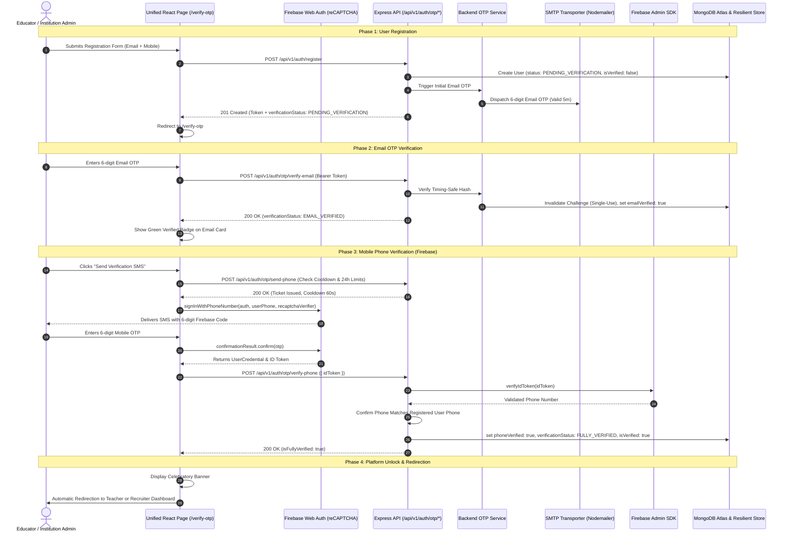
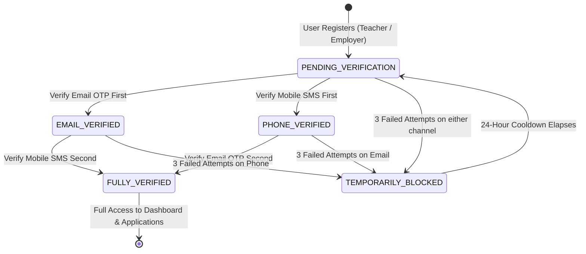

# SikchakHub.AI — Dual Email & Mobile OTP Verification System Design

**System Version:** 2.1.0 (Production Release)  
**Security Classification:** High (Identity & Authentication Gateway)  
**Target Platform:** SikchakHub / SikchaKhub.AI (Job Seeker & Job Poster Onboarding)

---

## 1. Architecture Overview & Workflow

The SikchakHub Dual Verification System mandates that all newly registered Job Seekers (`TEACHER`) and Job Posters (`EMPLOYER`) verify both their registered Email Address and Mobile Number before gaining access to platform dashboards and protected APIs.

---

## 2. Account Verification State Machine

Every user account follows a deterministic state machine managed by `verificationStatus`:

### State Definitions

| Status                 | Meaning                                             | Access Privileges                                                     |
| :--------------------- | :-------------------------------------------------- | :-------------------------------------------------------------------- |
| `PENDING_VERIFICATION` | New signup; neither channel verified.               | Restricted to `/verify-otp`, `/api/v1/auth/otp/*`, and public routes. |
| `EMAIL_VERIFIED`       | Email OTP verified; mobile phone pending.           | Restricted to `/verify-otp` until mobile number is verified.          |
| `PHONE_VERIFIED`       | Mobile SMS verified; email pending.                 | Restricted to `/verify-otp` until email is verified.                  |
| `FULLY_VERIFIED`       | Both email and phone verified (`isVerified: true`). | Full access to role dashboards, job posting, and applications.        |
| `TEMPORARILY_BLOCKED`  | 3 incorrect attempts recorded.                      | Locked out of verification for 24 hours.                              |

---

## 3. Server-Side Anti-Abuse & Rate Limiting Architecture

All verification gates, rate limits, and blockages are strictly computed and enforced on the backend. Frontend timers serve purely for user feedback.

### 3.1 60-Second Resend Cooldown

- On every OTP request (`send-email` or `send-phone`), the backend sets `resendCooldownUntil = now + 60s`.
- If an API request arrives before this timestamp, the backend rejects it with `429 Too Many Requests`:
  `"Please wait {N} seconds before requesting a new OTP."`

### 3.2 Maximum 3 Sends per 24-Hour Window

- Tracked via `sendCount24h` and `firstSendAt24h` in MongoDB.
- If $t_{\text{now}} - t_{\text{first}} < 24\text{ hours}$ and $\text{sendCount24h} \ge 3$, further requests are blocked:
  `"You have reached your OTP request limit. Please try again after 24 hours."`
- When 24 hours have elapsed, the window automatically anchors to the new request timestamp and the counter resets to 1.

### 3.3 24-Hour Temporary Lockout after 3 Failed Attempts

- If an incorrect OTP is submitted, `failedAttempts` is atomically incremented.
- Upon the 3rd failed attempt:
  - `isBlocked = true`
  - `blockedUntil = now + 24 hours`
  - The outstanding challenge is immediately invalidated to prevent brute-force attacks.
  - The user's status transitions to `TEMPORARILY_BLOCKED`.
  - All subsequent verification attempts during the 24-hour window return `429 Too Many Requests`:
    `"Too many incorrect OTP attempts. Your verification has been temporarily blocked for 24 hours."`

---

## 4. Single-Use Consumption & Replay Prevention

- Every OTP is valid for a maximum of 300 seconds (5 minutes).
- As soon as an OTP is successfully validated:
  - `isConsumed = true`
  - `consumedAt = now`
- Any duplicate submission of the same code is immediately rejected, preventing replay attacks.
