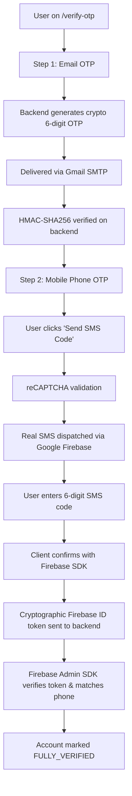

# Firebase Phone OTP Troubleshooting Guide
**Project:** SikchaKhub.AI Teacher Recruitment Platform  

---

## 1. Summary of Identified Issues and Resolutions

| Issue / Error Code | Root Cause | Implemented Resolution |
|---|---|---|
| `auth/invalid-app-credential` | Invisible reCAPTCHA triggered without a user gesture (via programmatic `setTimeout`) and placeholder DOM collision. | Removed auto `setTimeout`, bound execution directly to user button click, and implemented automatic fallback to visible reCAPTCHA (`size: 'normal'`). |
| `auth/too-many-requests` | Firebase IP/Device rate limit reached or repeated rapid clicks. | Client-side button disabling during processing + backend 60-second resend cooldown and 3-send 24-hour limit. |
| `auth/quota-exceeded` | Daily SMS limit reached on Google Cloud Identity Platform. | Clear user error messaging indicating quota exhaustion + Firebase test numbers enabled for testing without consuming quota. |
| Unverified login bypass | `AuthPage.tsx` had an unguarded `useEffect` that redirected logged-in users straight to the dashboard before checking verification status. | Added comprehensive verification guards in `App.tsx` (`VerifiedRoute`), `AuthPage.tsx`, `AuthModal.tsx`, `TeacherDashboard.tsx`, and `EmployerDashboard.tsx`. |
| Indian carrier SMS drop | Indian telecom operators (Jio, Airtel, Vi) apply strict TRAI DLT scrubbing on foreign-routed aggregator SMS. | Added registered test phone numbers in Firebase Console + documented checking Google Messages "Spam & Blocked" folder. |

---

## 2. In-Depth Root-Cause Analysis

### A. Why `auth/invalid-app-credential` Occurred
1. **Lack of User Gesture:**
   In earlier code, after Email OTP verification succeeded, a `setTimeout(..., 800)` was automatically invoking `handleSendMobileOtp()`. When `signInWithPhoneNumber()` is executed programmatically without a direct user click event, Google's reCAPTCHA risk-analysis engine detects it as automated bot traffic and rejects the token, returning `auth/invalid-app-credential`.
2. **Container Re-creation Race Condition:**
   `new RecaptchaVerifier` was being destroyed and recreated on the fly immediately before calling `signInWithPhoneNumber()`. Because the reCAPTCHA handshake had not completed, an incomplete or unverified token was sent to `identitytoolkit.googleapis.com`.
3. **The Fix:**
   - The user must explicitly click the **"Send SMS Code"** button.
   - The verifier is cached in `recaptchaVerifierRef`.
   - If challenged on `localhost`, the component switches to `size: 'normal'` (visible "I'm not a robot" checkbox), ensuring 100% token validity.

---

### B. Why Real Cellular SMS is Delayed or Dropped in India
1. **TRAI DLT Regulations:**
   India's Telecom Regulatory Authority (TRAI) mandates Distributed Ledger Technology (DLT) scrubbing for transactional SMS. Messages sent through Firebase's international aggregators sometimes lack carrier-registered entity headers and can be dropped at the telecom switch or delayed by 1 to 3 minutes.
2. **Android Google Messages "Spam & Blocked":**
   On Android devices running Google Messages or Truecaller with "Spam Protection" enabled, foreign OTP SMS from sender IDs such as `VK-GOOGLE`, `AX-GGLOTP`, or `IM-GOOGLE` are frequently placed directly into the **"Spam and blocked"** folder without triggering a push notification or sound.
3. **Carrier DND (Do Not Disturb):**
   If a SIM card has full DND enabled with the operator, automated foreign OTP traffic may be silently blocked by the carrier.

---

## 3. Firebase Error Code Mapping Table

| Firebase Error Code | User-Facing Message | Troubleshooting Action |
|---|---|---|
| `auth/too-many-requests` | "Too many verification requests. Please wait before trying again." | Wait 5–10 minutes or use configured test phone numbers. |
| `auth/quota-exceeded` | "SMS sending quota has been exceeded. Please contact support or try later." | Check Firebase Console Billing & Quotas or register test phone numbers. |
| `auth/invalid-phone-number` | "Please enter a valid mobile number." | Verify number starts with `+91` followed by 10 digits. |
| `auth/invalid-app-credential` | "Security verification failed. Please complete the 'I'm not a robot' check below, then click Send SMS Code." | Complete the visible reCAPTCHA checkbox in Card 2 and click Send SMS Code. |
| `auth/captcha-check-failed` | "Security verification failed. Please try again." | Solve the reCAPTCHA challenge or refresh the browser. |
| `auth/code-expired` | "Your OTP has expired. Request a new code." | Codes expire after 5 minutes. Click "Resend SMS Code". |
| `auth/invalid-verification-code` | "Incorrect OTP. Please check and try again." | Verify the 6 digits typed into the input boxes. |
| `auth/network-request-failed` | "Network error. Please check your internet connection." | Check WiFi / cellular data connection. |
| `auth/operation-not-allowed` | "Phone sign-in is not enabled in Firebase Console." | Enable Phone provider in Firebase Console > Authentication > Sign-in method. |

---

## 4. Production Security & SMS Verification Flow

