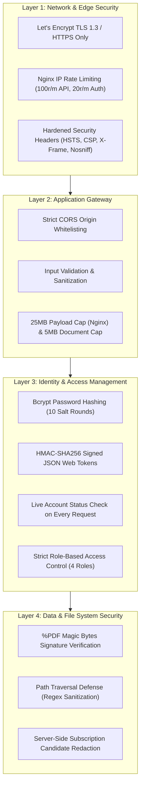

# SikchaKhub.AI — Security Policy & Hardening Guide

**Classification:** Enterprise Production Security Standard  
**Compliance Target:** OWASP Top 10, Data Protection Guidelines  
**Platform:** SikchaKhub.AI

---

## 1. Security Architecture & Defense-in-Depth



---

## 2. Authentication & Session Security

### 2.1 JWT Signature & Verification
- Tokens are signed with a cryptographically secure 256-bit secret key (`JWT_SECRET`).
- Tokens carry the standard payload `{ id, email, role }` and expire after 7 days.
- Secrets are sourced exclusively from environment variables and never checked into source control.

### 2.2 Live Account Status Verification
Unlike basic stateless JWT systems where revoked or suspended users can continue making requests until token expiration, SikchaKhub implements live verification:
```typescript
// authMiddleware.ts
const liveUser = await UserModel.findOne({ id: decoded.id }).select('status').lean();
if (liveUser && (liveUser.status === 'SUSPENDED' || liveUser.status === 'DEACTIVATED')) {
  return res.status(403).json({
    success: false,
    message: 'Access denied. Your account is suspended.'
  });
}
```
Any account suspended by Super Admin is instantly severed from API access.

---

## 3. Role-Based Access Control (RBAC) Matrix

| Resource / Endpoint | `TEACHER` | `EMPLOYER` | `HR` | `ADMIN` |
| :--- | :---: | :---: | :---: | :---: |
| Browse & Search Vacancies | Read | Read | Read | Read |
| Apply to Vacancy | Create | ❌ | ❌ | ❌ |
| Post & Edit Vacancies | ❌ | Owner Only | All | All |
| View First 5 Candidates | ❌ | Allowed | Allowed | Allowed |
| View Unlocked Candidates (>5) | ❌ | Premium Sub Only | Allowed | Allowed |
| Move Candidate Stages | ❌ | Allowed | Allowed | Allowed |
| Schedule Interviews | View (Self) | Allowed | Allowed | Allowed |
| Super Admin Master Dossiers | ❌ | ❌ | Read | Full CRUD |
| Manage Subscriptions & Fees | ❌ | ❌ | ❌ | Full CRUD |
| Audit Logs & Security Trails | ❌ | ❌ | ❌ | Read |

---

## 4. File Upload & Storage Hardening

Uploading arbitrary files presents severe risks of Remote Code Execution (RCE) and Cross-Site Scripting (XSS). SikchaKhub enforces four distinct barriers:

1. **Magic Bytes Validation:** Rather than trusting client MIME headers or extensions, the binary buffer is inspected for the 4-byte ASCII signature:
   ```typescript
   const magic = buffer.subarray(0, 4).toString('ascii');
   if (!magic.startsWith('%PDF')) {
     return res.status(400).json({ success: false, message: 'Invalid file signature. Only authentic PDFs are accepted.' });
   }
   ```
2. **File Size Enforcement:** Strictly capped at `5 * 1024 * 1024` bytes (5MB). Oversized payloads are rejected before disk writes.
3. **Path Traversal Defense:** Uploaded filenames are scrubbed:
   ```typescript
   const cleanName = (fileName || 'resume.pdf').replace(/[^a-zA-Z0-9.-]/g, '_');
   const storedFileName = `cv-${userId}-${Date.now()}-${cleanName}`;
   ```
   This prevents directory traversal characters (`../`, `\` etc.).
4. **Asynchronous File I/O:** All disk writes utilize `await fs.promises.writeFile`, preventing the Node.js event loop from freezing under concurrent uploads.

---

## 5. Network Security & HTTP Response Headers

The production Nginx and Express layers inject enterprise headers on all responses:

- `X-Frame-Options: SAMEORIGIN` (prevents Clickjacking)
- `X-Content-Type-Options: nosniff` (prevents MIME sniffing exploits)
- `X-XSS-Protection: 1; mode=block` (activates browser XSS filtering)
- `Referrer-Policy: strict-origin-when-cross-origin` (prevents leaking internal URL tokens)
- `Strict-Transport-Security: max-age=63072000; includeSubDomains; preload` (enforces HTTPS)

### CORS Configuration
CORS is locked down to authorized domains:
```typescript
const allowedOrigins = [
  'https://sikchakhub.in',
  'https://www.sikchakhub.in',
  'https://api.sikchakhub.in',
  'http://localhost:5173',
  'http://localhost:3000'
];
```
Wildcard `*` origins are completely forbidden in production.

