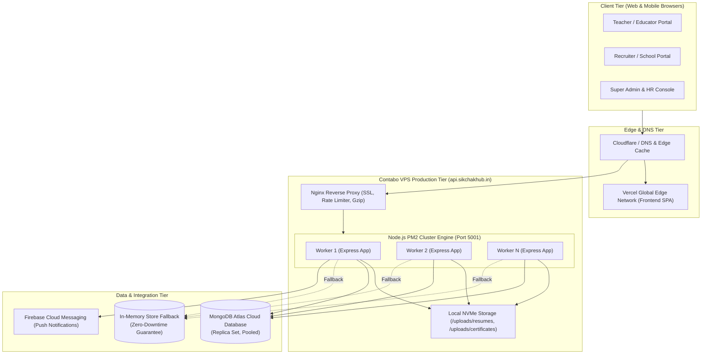
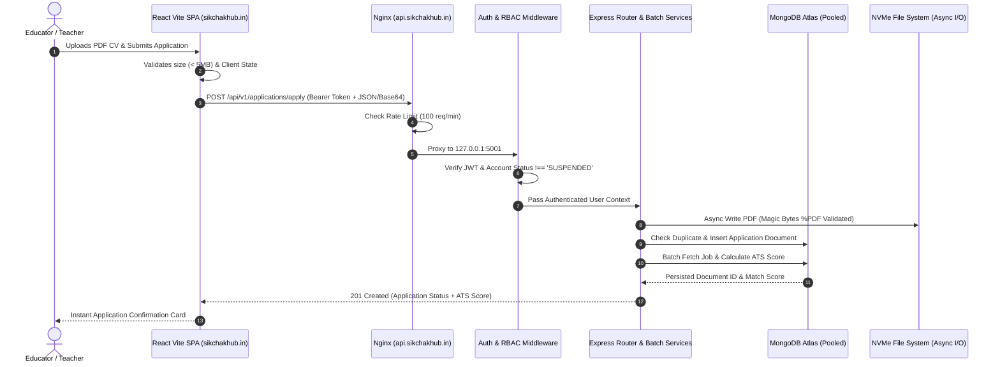

# SikchaKhub.AI — Complete System Design Document (HLD & LLD)

**Platform:** SikchaKhub.AI (AI-Powered Teacher & Faculty Recruitment Engine)  
**Version:** 2.0.0 (Production Release)  
**Author:** Senior Software & Systems Architecture Team  
**Domains:** `sikchakhub.in` (Frontend) | `api.sikchakhub.in` (Backend API)

---

## 1. Executive Summary & Platform Objectives

SikchaKhub.AI is India's dedicated institutional recruitment platform engineered specifically for schools, colleges, and premier coaching institutes (IIT-JEE, NEET, CBSE, ICSE, IB). The platform bridges the gap between verified educators and hiring institutions through:

- **AI-Powered ATS Matching:** Dynamic scoring of teacher qualifications, experience, and subject expertise against vacancy parameters.
- **Tiered Access & Subscription Model:** Free posting with automated screening for the first 5 candidates, and premium subscription access for high-volume hiring.
- **Enterprise Governance Console:** Super Admin and HR consoles enabling multi-stage candidate pipelines, audit trails, and interview orchestration.
- **High-Performance Resilient Architecture:** Hybrid MongoDB Atlas cloud persistence with zero-downtime in-memory fallback store and PM2 multi-core cluster execution.

---

## 2. High-Level Architecture (HLD)

---

## 3. Low-Level Architecture (LLD) & Component Flow

---

## 4. Subsystem Specifications

### 4.1 Authentication & Authorization Subsystem
- **JSON Web Tokens (JWT):** Signed using HMAC-SHA256 with 7-day expiration for mobile educator convenience and secure token validation on every request.
- **Account State Verification:** On every authenticated request, user status is checked against MongoDB (`status !== 'SUSPENDED' && status !== 'DEACTIVATED'`) to immediately invalidate revoked sessions without waiting for JWT expiry.
- **Role-Based Access Control (RBAC):** Middleware hierarchy enforcing granular privileges:
  - `TEACHER`: Can manage personal dossier, browse jobs, submit applications, view interview schedules.
  - `EMPLOYER`: Can post vacancies, review candidates up to free/subscribed quota, schedule interviews, view candidate dossiers.
  - `HR`: Can access recruiter pipelines, move candidates across stages, add screening notes, schedule interviews across all institutions.
  - `ADMIN`: Global governance, subscription management, user suspension, fee controls, audit log oversight.

### 4.2 Candidate Application & ATS Scoring Subsystem
- **Automated Resume Parsing:** Extracts subject keywords, degrees, board experience, and years of classroom experience.
- **ATS Scoring Engine:** Computes weighted compatibility index:
  $$\text{ATS Score} = 0.35 \times S_{\text{subject}} + 0.25 \times S_{\text{experience}} + 0.20 \times S_{\text{qualification}} + 0.20 \times S_{\text{curriculum}}$$
- **Tiered Access Enforcement:** Employers on free plans have full candidate dossier access for the first 5 applicants per vacancy; applications $\ge 6$ are redacted at the database query level until subscription activation.

### 4.3 Database Access & Resilience Subsystem
- **Connection Pooling:** Mongoose configured with `maxPoolSize: 50`, `minPoolSize: 10`, `socketTimeoutMS: 45000`.
- **N+1 Elimination:** All administrative and dashboard listings utilize `$in` batch lookups and aggregation pipelines, guaranteeing $O(1)$ database trips regardless of listing length.
- **Fail-Safe Fallback:** In the event of network disruption to MongoDB Atlas, operations gracefully degrade to `dbStore` in-memory structures, maintaining platform availability.

---

## 5. Scalability & Growth Projections

| Horizon | Monthly Active Users | Active Vacancies | Monthly Applications | Strategy |
| :--- | :--- | :--- | :--- | :--- |
| **Phase 1 (Current)** | 25,000 | 1,000 | 15,000 | Single Contabo VPS (4 vCPU, 8GB RAM), PM2 Cluster (4 workers) |
| **Phase 2 (6 Months)** | 150,000 | 10,000 | 120,000 | Contabo VPS (8 vCPU, 16GB RAM) + Redis Session Cache |
| **Phase 3 (18 Months)** | 1,000,000+ | 75,000 | 1,000,000+ | Horizontal PM2 instances behind Nginx Load Balancer + S3 Cloud Storage |

